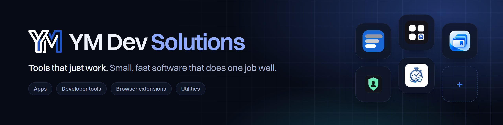

<h3 align="center">Small, fast software that does one job well.</h3>

  
  
  

---

**YM Dev Solutions** is a small software studio. We build apps, web tools, developer tools and browser extensions. Each one does one job, quickly, and then gets out of your way.

- **No bloat.** No account unless it's needed, and nothing running in the background without a reason.
- **Kept working.** Browsers and APIs change. We update our tools and answer support requests ourselves.
- **Your idea, built.** Many of our tools started as someone's suggestion. [Pitch us yours](https://ymdevsolutions.onrender.com/en/contact).

## Released

<table>
  <tr>
    <td width="72" align="center"></td>
    <td><b><a href="https://ymdevsolutions.onrender.com/en/projects/tabmail">TabMail</a></b> Fully customizable tabs for Gmail: colors, icons, groups, unread badges, custom search filters and more.</td>
    <td align="center"><a href="https://chromewebstore.google.com/detail/tabmail/gccbaemahdbndlkbcclaompnfnaanjld">Install</a></td>
  </tr>
  <tr>
    <td align="center"></td>
    <td><b><a href="https://ymdevsolutions.onrender.com/en/projects/dashtab">Dashtab</a></b> A fully customizable new tab dashboard: background, widgets, weather, clock, to-dos and Google shortcuts.</td>
    <td align="center"><a href="https://chromewebstore.google.com/detail/dashtab/igkakfogjgeebbfdpogffbcjeminmhic">Install</a></td>
  </tr>
  <tr>
    <td align="center"></td>
    <td><b><a href="https://ymdevsolutions.onrender.com/en/projects/finishlater">FinishLater</a></b> Save unfinished webpages, clear your tabs, and come back to them with a reminder.</td>
    <td align="center"><a href="https://chromewebstore.google.com/detail/finishlater/noifggioedllbmnhcjambnhiicakcmkn">Install</a></td>
  </tr>
  <tr>
    <td align="center"></td>
    <td><b><a href="https://ymdevsolutions.onrender.com/en/projects/profilevault">ProfileVault</a></b> Lock your whole Chrome profile with a password. Windows close on lock and reopen as you left them when you unlock.</td>
    <td align="center"><a href="https://chromewebstore.google.com/detail/profilevault/kpgfpdookjopecfokjlhdfnidlnopjna">Install</a></td>
  </tr>
  <tr>
    <td align="center"></td>
    <td><b><a href="https://ymdevsolutions.onrender.com/en/projects/delayed-send">Delayed Send for Claude.ai</a></b> Type your next Claude.ai prompt now and have it sent automatically once your usage limit resets.</td>
    <td align="center"><a href="https://chromewebstore.google.com/detail/delayed-send-for-claudeai/lkgbafpinkcmohbalmdkoccmbpififpm">Install</a></td>
  </tr>
</table>

More are on the way. See everything at **[ymdevsolutions.onrender.com/projects](https://ymdevsolutions.onrender.com/en/projects)**.

## Get in touch

Questions, support, or a tool you wish existed: email **[ymdevsolution@gmail.com](mailto:ymdevsolution@gmail.com)** or use the [contact form](https://ymdevsolutions.onrender.com/en/contact). We reply to every message.

The site is also available in <a href="https://ymdevsolutions.onrender.com/he">עברית</a> · <a href="https://ymdevsolutions.onrender.com/es">Español</a> · <a href="https://ymdevsolutions.onrender.com/fr">Français</a> · <a href="https://ymdevsolutions.onrender.com/ar">العربية</a> · <a href="https://ymdevsolutions.onrender.com/hi">हिन्दी</a>
