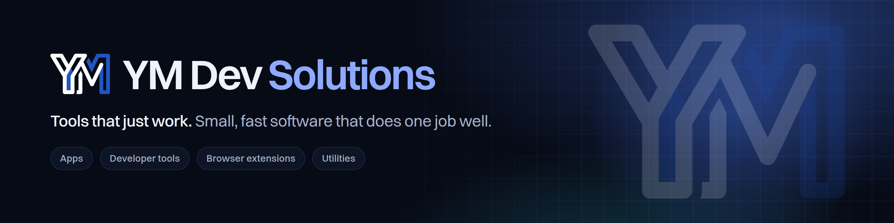

<h3 align="center">Small, fast software that does one job well.</h3>

  
  
  

---

**YM Dev Solutions** is a small software studio. We build apps, web tools, developer tools and browser extensions. Each one does one job, quickly, and then gets out of your way.

- **No bloat.** No account unless it's needed, and nothing running in the background without a reason.
- **Kept working.** Browsers and APIs change. We update our tools and answer support requests ourselves.
- **Your idea, built.** Many of our tools started as someone's suggestion. [Pitch us yours](https://ymdevsolutions.onrender.com/en/contact).

## Released

<!-- projects:start -->
_First releases coming soon._
<!-- projects:end -->

This list updates itself from the website. See <a href="HOW-TO-ADD-PROJECTS.md">how to add a project</a>.

More are on the way. See everything at **[ymdevsolutions.onrender.com/projects](https://ymdevsolutions.onrender.com/en/projects)**.

## Get in touch

Questions, support, or a tool you wish existed: email **[ymdevsolution@gmail.com](mailto:ymdevsolution@gmail.com)** or use the [contact form](https://ymdevsolutions.onrender.com/en/contact). We reply to every message.

The site is also available in <a href="https://ymdevsolutions.onrender.com/he">עברית</a> · <a href="https://ymdevsolutions.onrender.com/es">Español</a> · <a href="https://ymdevsolutions.onrender.com/fr">Français</a> · <a href="https://ymdevsolutions.onrender.com/ar">العربية</a> · <a href="https://ymdevsolutions.onrender.com/hi">हिन्दी</a>
